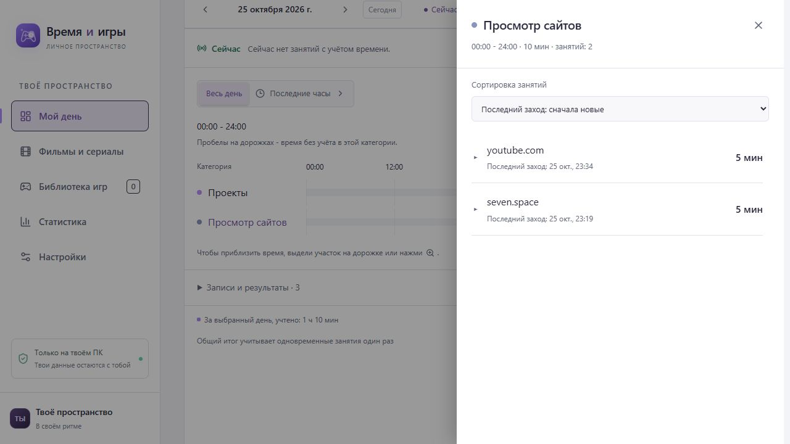

<div align="center">
  
  <h1>Time &amp; Games</h1>
  <p>Твоё время, проекты и любимые истории в одном месте.</p>
  <p>
    <a href="https://github.com/GameModify/time-and-games/releases/latest"><strong>Скачать сайт</strong></a> ·
    <a href="https://github.com/GameModify/activity-tracker/releases/latest">Скачать трекер и расширение</a> ·
    <a href="docs/tracking.md">Подключение</a>
  </p>
  <p>
    
    
    
  </p>
</div>

Локальный трекер времени с библиотеками игр, фильмов и сериалов. Планируй занятия, сохраняй впечатления и смотри, на что уходят дни. Без регистрации и обязательного облака.

## Три части одной системы

| Компонент | Для чего нужен | Как запускается |
| --- | --- | --- |
| **Time & Games** · этот репозиторий | Таймеры, история, графики и библиотеки | Самостоятельный локальный сайт |
| **[Activity Tracker](https://github.com/GameModify/activity-tracker)** | Автоматический учёт приложений Windows, игр и документов | Отдельное приложение в трее |
| **[Расширение Chrome](https://github.com/GameModify/activity-tracker#расширение-chrome)** | Сайты, видео и действия во вкладках | Подключается к Activity Tracker; поставляется с ним |

> **Начни с сайта.** Он полностью работает без трекера. Для автоматизации добавь Activity Tracker и расширение Chrome. Трекер может собирать данные без открытого сайта; сайт нужен для удобного просмотра, классификации и анализа истории.

## Быстрый старт

1. Установи **[Node.js 24.12+ с npm](https://nodejs.org/)**.
2. Скачай **`TimeAndGames-0.1.0.zip`** из [релизов](https://github.com/GameModify/time-and-games/releases/latest) и распакуй в отдельную папку.
3. Открой **«Запустить Time & Games.bat»**.
4. Перейди на **[127.0.0.1:3535](http://127.0.0.1:3535)**. Окно сервера оставь открытым.

Интерфейс уже собран. Первый запуск скачивает зависимости сервера; последующие не требуют интернета. Сеть нужна для внешних каталогов и обложек. Рядом с архивом опубликован `SHA256SUMS.txt`.

<details>
<summary><strong>Хочу автоматический учёт: подключить трекер и Chrome</strong></summary>

1. Установи [Activity Tracker](https://github.com/GameModify/activity-tracker/releases/latest) и запусти его.
2. Из меню значка в трее открой настройки трекера и скопируй ключ для сайта.
3. В Time & Games открой **Настройки → Автоматический учёт**, укажи `http://127.0.0.1:3536` и ключ.
4. В меню трекера открой папку браузерного расширения. На `chrome://extensions` включи режим разработчика и загрузи эту папку как распакованное расширение.
5. В настройках расширения укажи локальный сервис и ключ отправки. Включи нужные сайты или сбор на всех сайтах.

Сайт и трекер запускаются независимо. Для Windows-сборщиков расширение не требуется; для активности Chrome оно нужно. Подробная [инструкция подключения](docs/tracking.md).

</details>

## Что умеет

| Время и работа | Игры и просмотр |
| --- | --- |
| Несколько таймеров, пауза и продолжение | Игры, фильмы и сериалы в отдельных библиотеках |
| История с реальными перерывами | Статусы, избранное, даты и отзывы |
| Сводки дня, недели и месяца | Оценки от 0,5 до 10 с шагом 0,5 |
| Сайты и приложения в категориях и проектах | Steam, обложки, рейтинг IMDb, сезоны и серии |
| Настраиваемые карточки и последние 2–24 часа | Прогресс просмотра и история завершений |

<details>
<summary><strong>Точный учёт времени и пересчёт истории</strong></summary>

- Параллельные занятия остаются отдельными категориями, общий итог считает пересечения один раз.
- Пауза не завершает занятие: рабочие отрезки суммируются, промежутки остаются пустыми.
- Назначение сайта категории или проекту обновляет прошлые записи и статистику.
- Сайты сортируются по последнему заходу, затраченному времени и названию.
- Ручные записи и редактирование доступны независимо от трекера.

</details>

<details>
<summary><strong>Библиотеки и внешние каталоги</strong></summary>

Ищи игры в Steam, фильмы и сериалы в кинокаталоге, загружай обложки и сохраняй личные впечатления. Для сериала можно отметить сезон и последнюю просмотренную серию. Русские названия подставляются при наличии перевода; карточку можно заполнить вручную.

Время библиотек хранится отдельно от таймлайна. Личные оценки независимы от внешнего рейтинга и не отправляются в IMDb. Каталоги, переводы и постеры зависят от доступности поставщиков.

</details>

<details>
<summary><strong>Посмотреть интерфейс: сайты и сортировка</strong></summary>

Светлая тема и список посещений на демонстрационных данных.



</details>

## Данные под контролем

SQLite на твоём компьютере, JSON-копии в настройках, отдельная база трекера. В релиз не включены личные данные и ключи. Светлая и тёмная темы, профиль с собственным аватаром.

<details>
<summary><strong>Резервные копии и обновление</strong></summary>

База сайта находится в `data/time-and-games.sqlite`. Каталог `data/`, `.env`, ключи и личные данные не входят в релиз и Git. Настройки подключения хранятся на сервере и не возвращаются в браузер.

Перед обновлением сохрани JSON-копию в настройках. Распакуй новую версию отдельно, останови прежний сервер, запусти новый и восстанови копию. Подключение трекера настрой заново: его ключ не включается в JSON-копию. При переносе всей базы остановленного сайта можно перенести каталог `data/` целиком, включая SQLite WAL/SHM, если они существуют. Данные самого Activity Tracker находятся отдельно.

Не удаляй папку прежней версии до проверки истории и библиотек в новой. Сброс данных требует явного подтверждения; история отдельного сервиса Activity Tracker при этом сохраняется.

</details>

<details>
<summary><strong>Доступ из домашней сети</strong></summary>

По умолчанию сайт доступен только на своём компьютере. Для домашней сети создай `.env` в папке приложения:

```dotenv
TNG_LAN_HOST=192.168.1.10
```

Укажи фактический частный IPv4 своего компьютера и перезапусти сервер. Основной адрес продолжит работать. Удаление переменной отключает сетевой доступ. Не открывай сервер в интернет: в первом релизе нет авторизации, разрешённые устройства могут читать и менять общие данные. Activity Tracker остаётся на loopback.

</details>

<details>
<summary><strong>Разработка и проверки</strong></summary>

Для разработки используй Git-репозиторий или отдельный архив **Source code** со страницы релиза. Пользовательский ZIP предназначен для запуска готового сайта; тесты и конфигурация разработки остаются в исходниках.

```powershell
node scripts/npm.ts ci
node scripts/npm.ts run dev
```

Интерфейс разработки: [127.0.0.1:5173](http://127.0.0.1:5173), API: порт 3535. Для production-запуска исходников сначала выполни `node scripts/npm.ts run build`, затем `node server/index.ts`. В checkout Windows launcher собирает интерфейс при запуске; готовый релиз сборки не требует.

`node scripts/npm.ts` запускает npm из установки активного Node.js, обходя устаревший глобальный shim. Windows launcher ограничивает TLS своими процессами до 1.2 для совместимости с локальными сетевыми фильтрами; проверка сертификатов остаётся включённой.

```powershell
node scripts/npm.ts run verify
```

Проверяются строгие типы, границы архитектуры, ESLint, форматирование, production-сборка и регрессии API/времени. Функции ограничены 20 строками и когнитивной сложностью 20. Правила: [CONTRIBUTING.md](https://github.com/GameModify/time-and-games/blob/main/CONTRIBUTING.md), [архитектура](https://github.com/GameModify/time-and-games/blob/main/docs/architecture.md).

</details>

<details>
<summary><strong>Подготовка релиза</strong></summary>

На Windows после полной проверки выполни `npm run package:release` и `npm run smoke:release`. Пакет содержит `dist`, сервер с необходимыми локальными модулями, production-манифест и lockfile, launcher и пользовательскую документацию. Тесты, исходники интерфейса и конфигурация разработки исключаются явным списком файлов. Личные данные не копируются. Проверка распаковывает архив во временную папку, запускает Windows launcher с production-зависимостями, проверяет страницы и сохранность профиля после повторного запуска без сети. Тест не открывает браузер и не использует рабочую базу.

[Состав пакета и правила выпуска](https://github.com/GameModify/time-and-games/blob/main/docs/release-packaging.md).

Тег `vX.Y.Z`, совпадающий с `package.json`, запускает повторные проверки и публикует ZIP с SHA-256. [Описание 0.1.0](docs/releases/0.1.0.md).

</details>

## Лицензия

Собственный код проекта доступен по [Sustainable Use License 1.0](LICENSE.md). Разрешены личное и некоммерческое использование, изменения и использование внутри своей компании. Распространение разрешено бесплатно для некоммерческих целей; продажа копий и предоставление приложения как внешнего платного сервиса требуют отдельного разрешения правообладателя.

Это **source-available**, а не лицензия open source по определению OSI. Сторонние компоненты сохраняют собственные лицензии и авторство.
